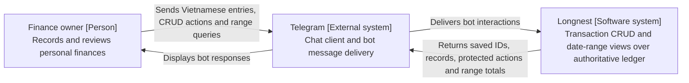
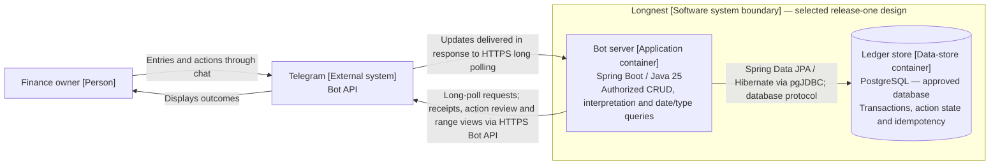
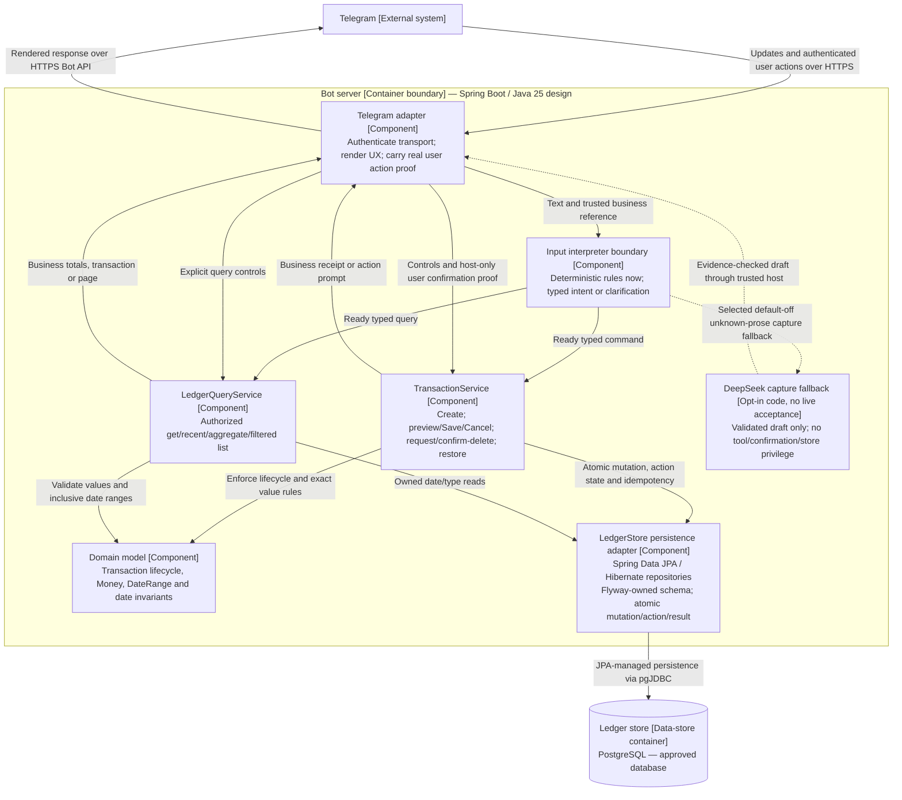

# C4 design and stack preferences

All views describe the **selected release-one logical design**, not implemented or deployed
infrastructure. Logical boundaries follow official C4 guidance for
[System Context](https://c4model.com/diagrams/system-context),
[Container](https://c4model.com/diagrams/container) and
[Component](https://c4model.com/diagrams/component) views (consulted 2026-10-20).
Mermaid flowchart notation expresses those views without installing a toolchain.
Key: `[Person]` is an actor, `[External system]` is outside Longnest, a system
boundary owns containers, and the server boundary owns logical components.
Arrows name directed interactions; storage cylinders are data-store containers,
not claims of separate hosts. No code-level diagram is needed.

## System Context — Longnest system scope

One personal finance owner is approved; multi-user support is not current scope.
No bank, Excel system or LLM is required in the current context.
Telegram carries financial input; local storage does not remove that external
privacy boundary. Host/operator identity and backup custody remain undecided.

## Container — inside the Longnest system

Select one bot-server instance with a PostgreSQL database-server dependency, not an
embedded store or a new queue/microservice tier. PostgreSQL is approved for dev,
integration tests and eventual operation, not an H2/production split. Its data-store
container identifies responsibility, not a provisioned host, Docker deployment or
paid service. JPA/Hibernate and Flyway remain required. Long polling needs no public
webhook. Exact database version, driver/module artifacts and Java 25 compatibility
need later evidence; database/application hosts and backup custody remain unselected.
See the canonical
[persistence boundary](SERVICES.md#persistence-and-query-consistency). No webhook
endpoint or infrastructure has been provisioned. Telegram documents mutually
exclusive polling/webhook delivery and `update_id` for duplicate handling in the
[Bot API](https://core.telegram.org/bots/api#update); delivery IDs are not ledger IDs.

## Focused Component — inside the bot server

This OOP view separates adapters from callable application services and cohesive
domain objects. These are selected logical responsibilities, not implemented
classes/files, deployed services or a code-level diagram. See the canonical
[OOP/service/tool contracts](SERVICES.md); no business rules belong only in Telegram.

Solid paths are current design; dotted paths show the selected default-off capture
fallback, not live transmission. A general tool adapter and interpreter replacement
remain absent. No route bypasses application authorization, exact Money/DateRange validation,
idempotency, revision checks or durable consistency. Services return business results
to their caller; the adapter renders them. Models do not turn prose into a receipt.

Telegram-specific IDs/callbacks stay in the adapter. Domain Transaction/Money/
DateRange have no Telegram/model dependencies. The application accepts host-trusted
principal and opaque operation identity, not model-supplied permissions.
Persist a mutation, state/revision and action/idempotency outcome atomically.
Success follows commit; aggregate/list reads share active-record semantics.
Selected Edit uses previewUpdate then host-only update(actionId, real Save proof),
not a second patch supplied at commit. Delete/Save/Cancel are bound to the displayed
action; no model tool can invoke those host completions. Pending actions last 10
minutes durably, while bounded navigation cursors are ephemeral and generation-bound.
These states live within existing components, not an extra workflow infrastructure.
Confirmed reversible delete and restore are approved, not a choice of deletion mode.
Each application service has an interface and `@Service` implementation. The service
owns its Spring transaction; the `@Repository` adapter/repositories participate.
Short owner-head locks serialize atomic commands and coherent reads; internal
`@Version` guards do not replace public revision checks or action proof. Flyway
SQL owns schema changes, Hibernate validates mappings. [Backend rules](BACKEND_RULES.md)
specifies DTO/mapping, pagination and virtual-thread conventions. No extra container,
web controller, migration runner deployment or dependency installation is implied.

Delete request is callable; confirmDelete is host-only with proof from the actual
user action bound to the displayed owner/target/action/revision. No model tool may
supply that proof, set confirmed=true, call a repository or choose a different actor.
Restore uses the ordinary service and affects totals once. Retention/purge duration
is unresolved, not an invitation to permanent deletion or an event-sourcing framework.

[Domain date rules](DOMAIN.md#bot-capabilities-and-date-ranges) use inclusive local
transaction dates in Asia/Ho_Chi_Minh; VND and the single personal user are approved.
Overview, type aggregates and 10-entry lists are reusable queries. Date correction
is an update, not a separate financial implementation or reporting service.

## Deferred architecture

- Central future finance features: classification metadata, BudgetService and
  AllocationService are proposed same-application extensions, documented in the
  [feature slices](features/README.md) and [shared contracts](SERVICES.md#future-finance-capabilities).
  They reuse the authoritative ledger and current Money/date/access/replay rules;
  allowance settings and advisory plans are separate data, not expenses or transfers.
  No new deployment container, agent platform or prerequisite foundation project.
  Current C4 views remain release-one design; future finance is not silently
  represented as implemented components. A committed expense can succeed even if
  optional budget feedback is unavailable; recomputation/read recovers that view.
- Future client: React latest, TypeScript 7, Vite latest and Tailwind CSS latest in
  `apps/client/`, accessing the same server/ledger after an authentication/API design
  is approved. No public API endpoints or frontend are defined/implemented now.
- Optional LLM: selected default-off DeepSeek capture fallback uses the same typed
  draft/application services. Broader tools and interpreter replacement are absent.
  See [strategy examples](SERVICES.md#future-interpretation-strategies). Provider/
  cost/privacy approval precedes any external text processing; no live agent
  platform, model-owned store, access grant or confirmation shortcut.
- Excel/templates/export: optional derived output later, never authoritative and
  never a required dependency. Salary envelopes remain advice, not payment flows.
- No deployment view: runtime hosts, network topology, credentials, backup target
  and infrastructure are unknown. The target `deploy/` directory is not a deployment.

## Stack availability and limits

Preserve Spring Boot/Java 25 server preference and the later-client stack above.
Spring Data JPA/Hibernate and Flyway are required; direct-JDBC repositories are
superseded. PostgreSQL replaces H2 across application environments; supported 18
is a version proposal, not a selected or tested installation (see Services).
Java 25 virtual-thread execution follows
the [backend rules](BACKEND_RULES.md#virtual-thread-blocking-workload--requirement-12).
The backend starter and accepted increments now bind actual POM artifacts, including
MapStruct 1.6.3; compatibility evidence and limits are in CURRENT STATUS. No client
artifact combination is selected or installed. Earlier read-only research on
2026-10-20 found these release lines; recheck exact patches/peer ranges at authorized
implementation time rather than silently pinning or substituting:

| Preference | Official documentation finding | Remaining qualification |
| --- | --- | --- |
| React latest | [Versions](https://react.dev/versions) lists 19.3 | No client build/plugin compatibility verified. |
| TypeScript 7 | [7.0 release](https://devblogs.microsoft.com/typescript/announcing-typescript-7-0/) is production, not preview | 7.0 lacks a programmatic compiler API; API-dependent tooling may need TS6 compatibility tooling. Discuss explicitly; no fallback approved. |
| Vite latest | [Releases](https://vite.dev/releases) lists 8.3 regular-patch line; [guide](https://vite.dev/guide/) documents React/TS templates and Node 20.19+/22.12+ | Selected template may require newer Node. No package combination tested. |
| Tailwind latest | [4.3 announcement](https://tailwindcss.com/blog/tailwindcss-v4-3); official [Vite plugin](https://tailwindcss.com/docs/installation/using-vite) | [Modern browser baseline](https://tailwindcss.com/docs/compatibility) matters for later web; exact browser targets not chosen. |
| Spring Boot / Java 25 | [Boot 4.1.1 requirements](https://docs.spring.io/spring-boot/system-requirements.html) documents Java 17–26; [Java 25 documentation](https://docs.oracle.com/en/java/javase/25/) confirms release availability | No JDK distribution/store library or runtime build verified. Boot docs list Maven 3.6.3+ or Gradle 8.14+/9.x. |

The earlier direct read of `https://jdk.java.net/25/` failed; Oracle documentation
provided separate release evidence. Documentation compatibility is not proof of an
installed toolchain, a full-stack build, usable UI or deployed infrastructure.
